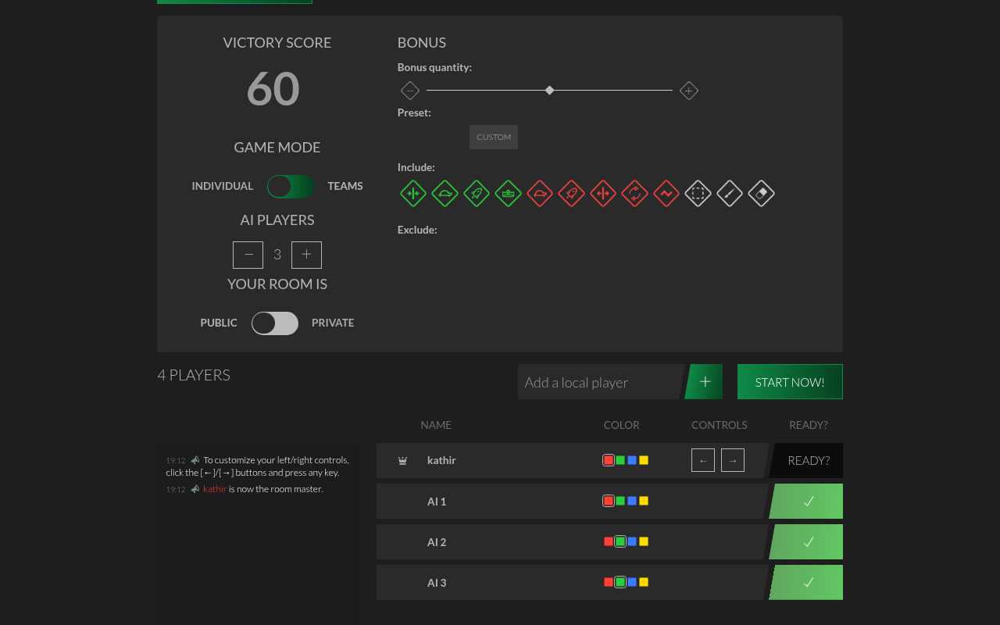
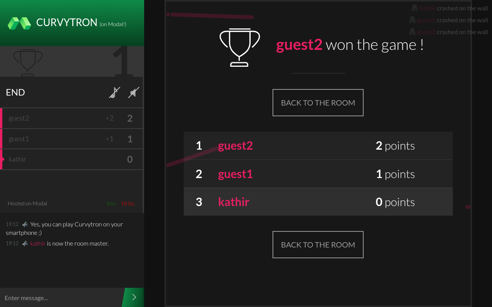

# Curvytron

This is our fork of [Curvytron](https://github.com/Curvytron/curvytron), running on our own infra! Read more on our [sticky sessions blog](https://modal.com/blog/serverless-routing-made-sticky).

Additions:

- Revamped backend, running on Modal sticky sessions
- UI tweaks
- Team mode
- AI bot optionality

... and much more!

| | |
|---|---|
|  |  |
|  |  |
